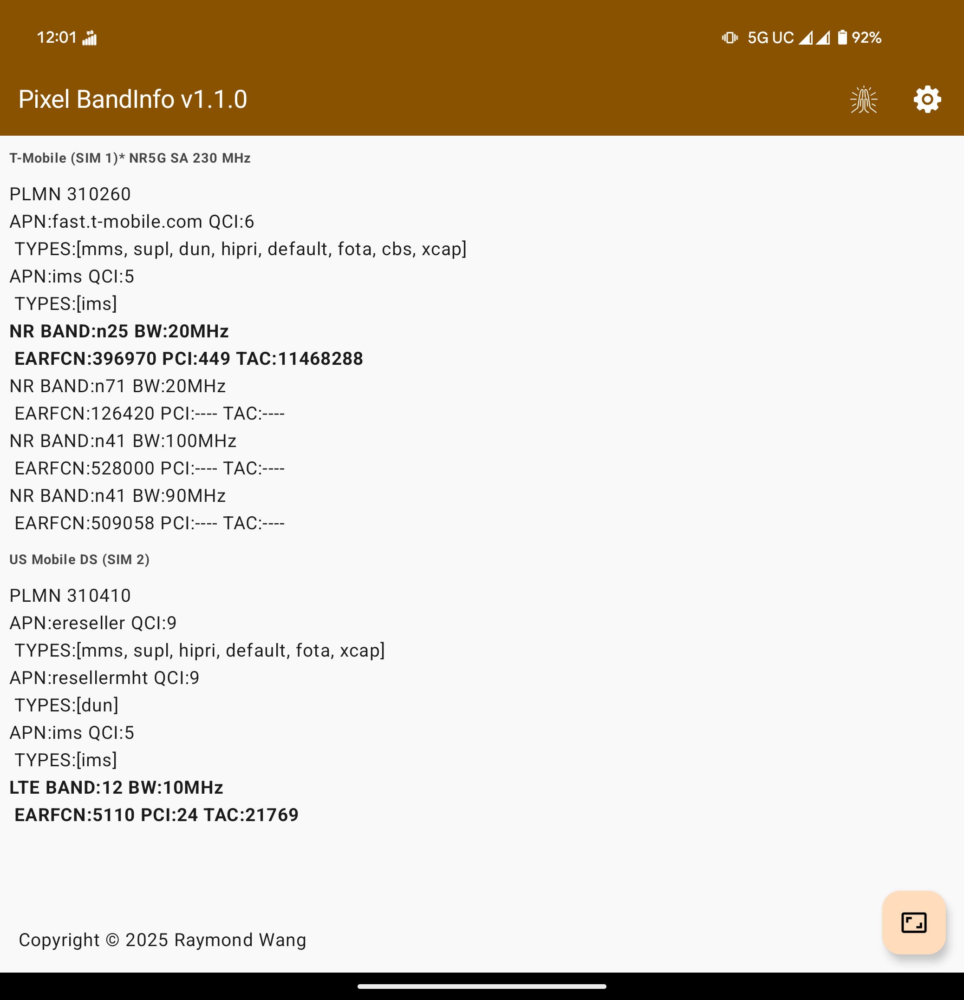
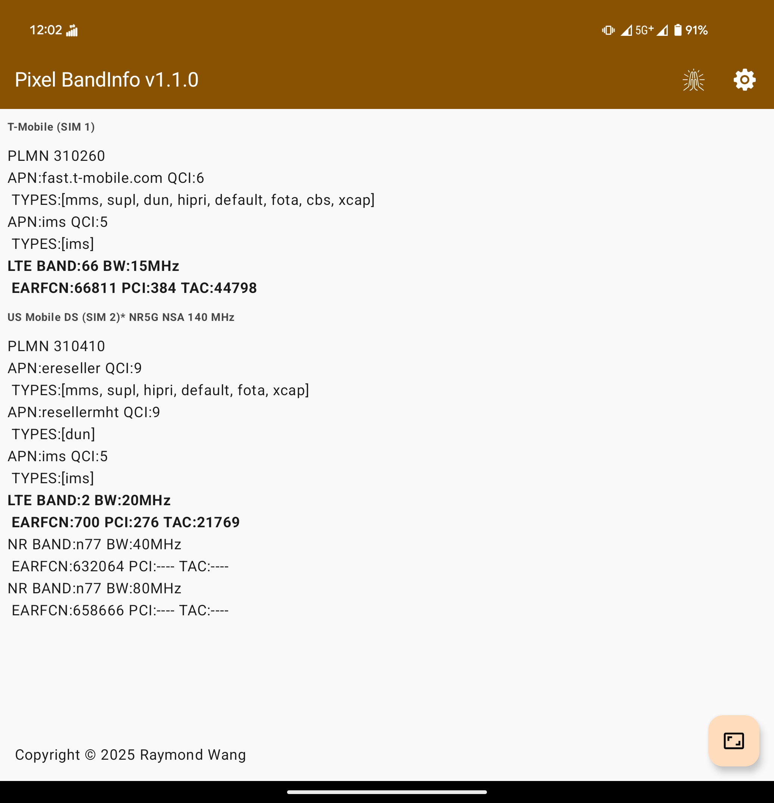
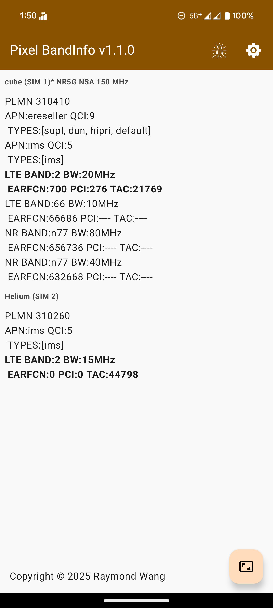
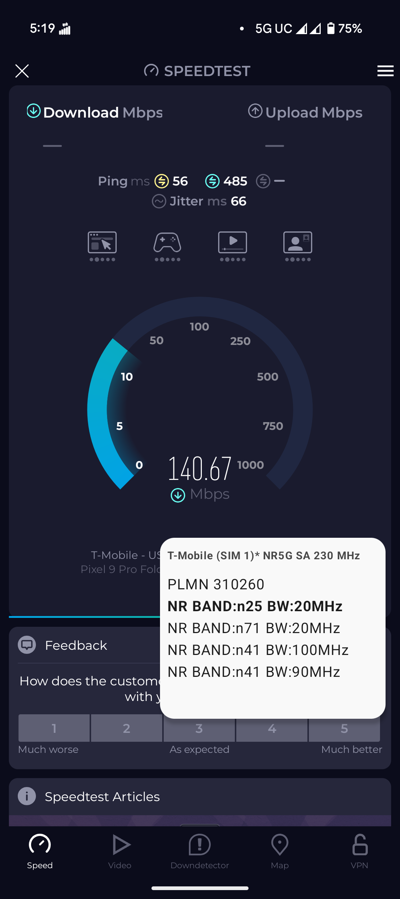
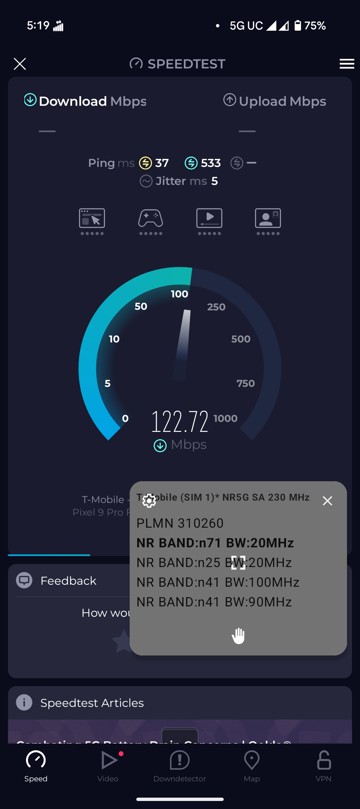

## Description

It's been a long time coming, but now it's finally here: a way to accurately view frequency bands AND QCI (Quality-of-Service Class Identifier) on Google Pixel phones, all WITHOUT root access! Previous solutions relied on limited, user-facing APIs and guesstimates, which meant we couldn't see exactly the bands that were being aggregated together, especially on 5G NR, or they relied on low-level modem APIs, requiring root access. And in the case of QCI, it wasn't possible AT ALL without root access, until now.

Heavily inspired by Samsung's "*#0011#" Service Menu; always wanted to be able to access that information on other devices, and now we can.

These are the parameters that could be be displayed,

- PLMN (MCC + MNC)

- Technology (5G NR, 4G LTE, 3G HSPA, 2G GSM)

- Frequency band number

- Bandwidth (in MHz), both raw and aggregate

- QCI (Quality-of-Service Class Identifier) (a.k.a Priority Data level)

- EARFCN

- PCI* (only visible on anchor band)

- TAC* (only visible on anchor band)

You can use the built-in resizeable, configurable Picture-in-Picture mode to view connected bands while you run speed tests.

## Demo

### Video

### Images

## How it works

It utilizes Shizuku to escalate privileges to access previously-hidden parameters within the OS. As such, Android OS updates and/or SoC updates can break it in the future.

## Notes

Tested and verified working on Pixel 8 Pro, Pixel 9 Pro Fold (official Android 16 update) and limited functionality on Motorola Edge 2022 (MotoUI Android 14, MediaTek SoC, supports viewing bands).

Confirmed to work on other devices by the community:

- Vivo X200 Pro confirmed by /u/runski1426: [/r/NoContract/comments/1lfmlvz/app_pixel_bandinfo_view_5g_nrlte_frequency_bands/mywac64/](https://www.reddit.com/r/NoContract/comments/1lfmlvz/app_pixel_bandinfo_view_5g_nrlte_frequency_bands/mywac64/)

Does not work on Samsung S24 Ultra, or Motorola Edge 2024, seems to me that Qualcomm messed with the internal APIs in such a way that breaks support.

## Credits

- Special thanks to Kyujin Cho for Pixel IMS - it was the basis for starting this app

- Google for the Android Open Source Project; thanks to their lack of initiative in building this into a publicly accessible feature in the OS, for inspiring and motivating me to do this

- Samsung - whose beloved Service Menu was the original inspiration for the UI and functionality
